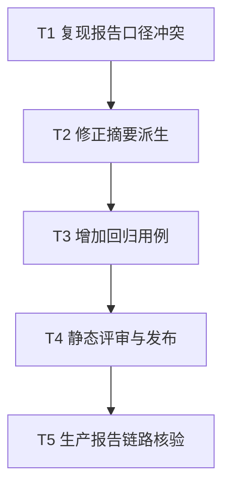

# 黑盒白名单报告摘要一致性任务拆分

## T1：复现报告口径冲突

- 输入：生产任务 `sbx_7d1ffc7ba9cb40c1bca743d3` 已下载报告及相应结构化执行记录。
- 输出：报告矛盾字段清单。
- 验收：证明三条 HTTP 请求及 AI 跳过证据存在，但摘要仍声称没有测试/跳过项。

## T2：修正摘要派生

- 输入：T1 与共识文档。
- 输出：`_sandbox_execution_disclosure()` 优先沿用显式 coverage，缺项时从精确白名单回执和 AI 生成状态进行有证据派生。
- 约束：不改变分数或总体验证门禁，不批量改写历史记录。

## T3：增加回归用例

- 输入：T2 实现。
- 输出：覆盖精确白名单回执完整/缺失、AI skipped/状态缺失、终止任务范围未知的测试。
- 约束：遵守用户的生产优先验收要求，本轮不在本机运行产品测试。

## T4：静态评审与发布

- 输入：T2、T3、部署规范。
- 输出：固定代码提交和同一发布版本的后端/前端产品发布。
- 验收：活动版本、健康状态与提交 SHA 一致。

## T5：生产报告链路核验

- 输入：既有生产任务执行记录。
- 输出：新报告摘要与逐项证据一致的可读回执。
- 约束：不重复运行第三方靶场，不批量覆盖历史报告；只用此次已保存回执通过现有终态 stop 路径修复已知矛盾报告。
